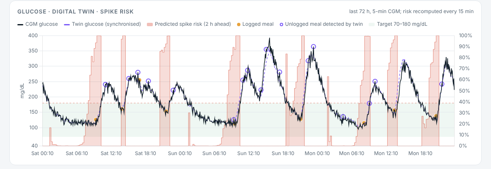
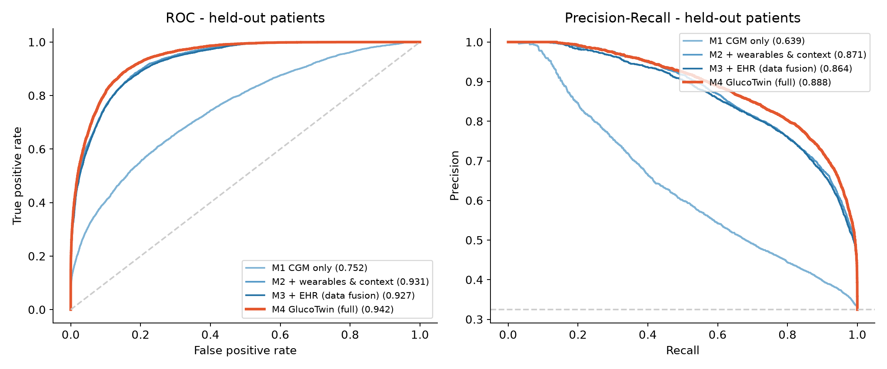

# GlucoTwin: a personal digital twin that forecasts Type 2 Diabetes glucose spikes 2 hours ahead

**Digital Twin Challenge 2026 · Happiest Health · Reimagining & Reforming Healthcare in India Summit**

> GlucoTwin fuses a patient's **Electronic Health Record** with **live wearable + CGM data** into a calibrated, continuously synchronised virtual patient. The twin forecasts the next two hours, and a hybrid ML layer turns that forecast into an early warning: **77% of spike episodes flagged a median 85 minutes before onset, with 0.79 false alerts per patient-day (4.6× fewer than a CGM-only model)** on patients the model never saw. Doctors can also run **what-if simulations** (smaller dinner, post-meal walk, short sleep, missed metformin) on the live twin.



---

## 1. Team and institution

| | |
|---|---|
| **Team name** | **Be Positive** |
| **Institution / incubator** | Indian Institute of Management Kozhikode (IIM Kozhikode), Kerala |
| **Team leader** | Raghav Madaan (mba25raghavm@iimk.ac.in) |


## 2. Project title

**GlucoTwin — Patient-specific digital twin for 2-hour glucose-spike prediction in Type 2 Diabetes**

## 3. Problem statement and healthcare use case

**Problem.** India has about 101 million people living with diabetes and 136 million with prediabetes (ICMR-INDIAB, *Lancet Diabetes & Endocrinology*, 2023). Care is still largely reactive: HbA1c is checked a few times a year and is a 90-day average that hides the daily post-meal spikes driving vascular damage. CGMs and smartwatches now produce the data, but they only show a spike after it has happened.

**Condition chosen.** Type 2 Diabetes and prediabetes (the challenge asks for one chronic or lifestyle condition prevalent in India).

**Adverse event predicted.** CGM glucose rising **above 180 mg/dL** (upper limit of the international time-in-range consensus) **at any time in the next 120 minutes**, predicted every 15 minutes, **only while the patient is still ≤ 180 mg/dL**, so every alert is a genuine early warning rather than detection of an ongoing excursion.

**User and decision.** The treating doctor or diabetes educator in an outpatient or clinic model (fitting Happiest Health's away-from-the-hospital clinics), plus nudges to the patient. The decision supported is acting **before or right after a meal**: portion size, a walk after eating, or a medication check.

## 4. Data: the two required streams (synthetic, DPDP/HIPAA-safe)

No real patient data is used anywhere. `src/generate_data.py` is a Synthea-style generator driven by physiology, so the EHR and the sensor traces are mutually consistent.

| Stream | Content | Files |
|---|---|---|
| **Static / historical (EHR)** | Demographics, BMI, waist, BP; ICD-10 diagnoses (E11.9, R73.03, I10); LOINC labs (HbA1c, fasting glucose, fasting insulin, LDL/HDL/TG, eGFR); medications (metformin, sulfonylurea, DPP-4i, basal insulin, statin, ACEi); genetic markers (TCF7L2 rs7903146, KCNQ1 rs2237892, FTO rs9939609 at South-Asian allele frequencies) | `data/ehr_patients.csv`, `data/fhir/*.json` (HL7 FHIR R4 bundles, ABDM-ready) |
| **Dynamic / real-time (wearables)** | CGM glucose (5-min, interstitial lag + sensor noise), heart rate, HRV (RMSSD), steps, sleep stages (wake / light / deep / REM), plus the patient's own **incomplete and noisy meal log** | `data/wearable_timeseries.csv.gz`, `data/meal_log.csv` |

**Cohort:** 100 patients (61 T2D, 24 prediabetes, 15 at-risk) × 14 days × 5-min samples = 403,200 rows. It models the "thin-fat" Asian-Indian phenotype, carbohydrate-heavy meals, late dinners, weekend shifts, festive meals, unlogged meals, post-dinner walks, poor sleep (which lowers next-day insulin sensitivity), and stress days (higher HR, lower HRV, raised hepatic glucose output).

The hidden physiology (`data/ground_truth/`) is **never read by the predictor**. It exists only so we can verify that the twin recovers each patient's true physiology, something real data cannot offer. The loader in `src/twin_engine.py` takes any dataset with the same columns, so MIMIC-IV, Synthea output or OhioT1DM can be swapped in.

## 5. How the digital twin works

```
EHR ──► 1. INITIALISE prior physiology ──► 2. CALIBRATE on 3 onboarding days
                                                    │
CGM / HR / HRV / steps / sleep / meal log ──► 3. SYNCHRONISE every 5 min (state observer + unlogged-meal detector)
                                                    │
                                          4. FORECAST 2 h ahead every 15 min ──► hybrid ML risk ──► alert + explanation
                                                    │
                                          5. WHAT-IF counterfactual simulation for the doctor
```

**Mechanistic core** (`src/physiology.py`): an extended Bergman minimal model with two-compartment gut absorption and an exercise uptake term.

```
dG/dt  = −(S_G + X + E)·G + S_G·G_b + Ra/(V·BW)       glucose
dX/dt  = −p2·X + p2·S_I·(I − I_b)                     remote insulin action
dI/dt  = −n·(I − I_b) + γ·max(G − h, 0)               insulin secretion
dQ1/dt = −k_abs·Q1 + carbs,  dQ2/dt = k_abs·(Q1 − Q2), Ra = f·k_abs·Q2   gut
dE/dt  = −E/τ + k_ex·activity                          exercise
```

1. **Initialise** (`ehr_prior`): insulin sensitivity S_I from HOMA-IR and BMI; β-cell response γ from diagnosis, TCF7L2/KCNQ1 genotype, sulfonylurea/DPP-4i; basal glucose from fasting glucose.
2. **Calibrate** (`calibrate`): MAP grid search over S_I and γ against 3 days of CGM using logged meals and steps, with a robust Huber loss (so forgotten meals don't distort the fit) and a log-normal prior that keeps the twin near the EHR unless the data disagree. Basal glucose comes from night-time CGM.
3. **Synchronise** (`run_twin`): every 5 minutes a state observer pulls virtual glucose onto the CGM. A sharp rise with no logged meal is treated as an **unlogged meal**, and the implied carbs are injected into the gut compartment.
4. **Forecast**: every 15 minutes the twin is simulated 2 hours ahead under "no further meal" and "habitual routine" scenarios. The routine uses a meal-time profile learned during onboarding.
5. **What-if** (`export_dashboard.py`): 24-hour counterfactuals from the live twin state. Dinner carbs −25/−50%, a 15/30-min post-dinner walk, a short night's sleep (S_I −20% next day), and a missed metformin dose.

**Hybrid ML risk layer** (`src/features.py`, `src/train_evaluate.py`): scikit-learn `HistGradientBoostingClassifier` on **58 fused features in 5 streams**:
- **CGM dynamics**: level, 15/30/60-min slopes, acceleration, 2-h and 24-h statistics, time in range, time since the last high.
- **Wearables**: HR and its change, HRV relative to the patient's baseline, steps, last night's sleep hours, deep and REM fractions, night HRV.
- **Context and meal log**: time of day, weekend, logged carbs.
- **EHR**: the static clinical record.
- **Digital twin**: forecast peaks and means, habitual-meal probability, personalised S_I and γ, unlogged carbs detected, synchronisation residual.

**Explainability:** for every alert the dashboard shows each stream's contribution in log-odds (risk with the stream set to the cohort median vs. actual), plus plain-language reasons and a suggested action.

## 6. Results (30 held-out patients never seen in training)

Patient-level split: 70 train / 30 test patients. Alert threshold fixed on training patients (80% sample-level sensitivity).

| Model | AUROC | AUPRC | Spike episodes caught | Median warning | False alerts / patient-day |
|---|---|---|---|---|---|
| Rule: CGM > 140 and rising | 0.546 | 0.376 | 54% | 10 min | 0.40 |
| M1 CGM only | 0.752 | 0.639 | 87% | 90 min | 3.61 |
| M2 + wearables & context | 0.931 | 0.871 | 79% | 80 min | 0.99 |
| M3 + EHR (plain data fusion) | 0.927 | 0.864 | 78% | 75 min | 0.83 |
| **M4 GlucoTwin (full)** | **0.942** | **0.888** | **77%** | **85 min** | **0.79** |

- **Twin fidelity.** Calibration cuts the error in recovered insulin sensitivity by **30%** compared with the EHR-only prior (vs. hidden ground truth). Open-loop 3-day RMSE falls from 51.1 to 45.9 mg/dL. Synchronised twin MAE is **6.8 mg/dL**.
- **Subgroups.** AUROC is 0.94 for T2D, 0.94 for prediabetes and 0.93 for at-risk patients. Probabilities are well calibrated (`outputs/figures/calibration.png`).
- **Finding.** The EHR adds little as raw model input, but it is valuable for **initialising the twin**. The twin features deliver the gain over plain fusion.



## 7. Conceptual UI: working doctor dashboard

Open **`dashboard/index.html`** in any browser. There is no server or install, and Chart.js is vendored for offline use.

- Patient list ranked by live 2-hour spike risk.
- 72-hour timeline: CGM, twin glucose, logged and detected meals, live risk.
- KPIs: current risk, time in range, GMI, spikes, glycaemic variability (CV).
- "Why this alert" panel with stream contributions, plain-language reasons and a suggested action.
- Twin physiology: EHR prior vs calibrated parameters and fit.
- **What-if simulator:** dinner carbs, walk, sleep, metformin, with the post-dinner peak, minutes above 180 and 24-hour TIR.
- Wearables: HR and HRV, steps, sleep hypnogram.
- **Model performance** tab: ablation table, ROC/PR, calibration and stream-importance charts.

Screenshots: [`docs/dashboard_patient_view.png`](docs/dashboard_patient_view.png), [`docs/shot_whatif.png`](docs/shot_whatif.png), [`docs/dashboard_model_view.png`](docs/dashboard_model_view.png).

## 8. Technical stack

| Layer | Tools |
|---|---|
| Language | Python 3.10+ |
| Simulation / twin | NumPy (vectorised ODE integration across patients and candidate parameters) |
| Data | pandas, FHIR R4 JSON |
| ML | scikit-learn `HistGradientBoostingClassifier`, permutation importance, calibration curves |
| Plots | Matplotlib |
| Dashboard | HTML + vanilla JS + Chart.js 4 (vendored) |
| Docs | pptxgenjs (presentation), HTML → PDF (architecture) |

## 9. Run it

```bash
pip install -r requirements.txt
python run_all.py          # ~1 min: data → calibrate 100 twins → synchronise & forecast → train/evaluate → dashboard
# then open dashboard/index.html
python tests/test_smoke.py # quick sanity checks
```

All randomness is seeded, so results reproduce exactly.

## 10. Repository structure

```
BePositive_IIMKozhikode/
├── run_all.py                  # end-to-end pipeline
├── src/
│   ├── physiology.py           # mechanistic glucose–insulin–gut–exercise model
│   ├── generate_data.py        # synthetic EHR + wearable cohort, FHIR export
│   ├── twin_engine.py          # initialise, calibrate, synchronise, forecast, what-if
│   ├── features.py             # stream fusion + adverse-event labels
│   ├── train_evaluate.py       # ablation M0–M4, event-level metrics, figures
│   └── export_dashboard.py     # dashboard payload incl. what-if scenarios
├── dashboard/                  # index.html, data.js, vendor/chart.js, figures/
├── data/                       # generated synthetic data (EHR, wearables, meal log, FHIR, ground truth)
├── outputs/                    # metrics.json, model, calibration report, predictions, figures
├── video/                      # animated explainer: script.py (dialogue), tts.py (Kokoro voices), characters.py, render.py
├── docs/
│   ├── Architecture_Diagram.pdf
│   ├── GlucoTwin_Presentation.pptx / .pdf
│   ├── VIDEO_SCRIPT.md         # 20+ min narration (also in the PPT speaker notes)
│   └── screenshots
└── tests/test_smoke.py
```

## 11. Submission artefacts

| Requirement | Location |
|---|---|
| Team details & college | Section 1 |
| Project title | Section 2 |
| Problem statement & use case | Section 3 |
| Technical stack, AI/ML details | Sections 5 and 8 |
| **Video (≥ 20 min)** | **`[UNLISTED YOUTUBE LINK]`**: an animated explainer in which Dr. Meera (a clinician) and Gluco (the digital twin) walk through the model and the dashboard. It is generated by code in [`video/`](video/): the dialogue is in `script.py`, voices are produced with the open-weight Kokoro TTS model (`tts.py`), and the characters, lip-sync and subtitles are rendered by `render.py`. A presenter script is in [`docs/VIDEO_SCRIPT.md`](docs/VIDEO_SCRIPT.md) |
| Open-source license | [MIT](LICENSE), Section 13 |
| Architecture diagram (PDF) | [`docs/Architecture_Diagram.pdf`](docs/Architecture_Diagram.pdf) |
| Presentation (PPT/PDF) | [`docs/GlucoTwin_Presentation.pptx`](docs/GlucoTwin_Presentation.pptx), [`docs/GlucoTwin_Presentation.pdf`](docs/GlucoTwin_Presentation.pdf) |

## 12. Limitations and responsible AI

- **Synthetic data only.** The results demonstrate the method and the value of each component; they are not a claim of clinical accuracy. Real-world validation (OhioT1DM, MIMIC-IV, de-identified partner-clinic data under DPDP consent) is the next step.
- The minimal model simplifies physiology: no glucagon, and meals are carbohydrate-only (no fat, protein or fibre effects). It can be upgraded to UVA/Padova.
- Habitual meal timing is a strong signal, so irregular eaters (e.g., shift workers) will be harder to predict.
- **Decision support only.** A clinician stays in the loop and the system never doses autonomously. Clinical deployment would follow the CDSCO Software-as-a-Medical-Device pathway.

## 13. License

Released under the **MIT License** (see [`LICENSE`](LICENSE)). Third-party: Chart.js (MIT). All data in this repository is synthetic.
